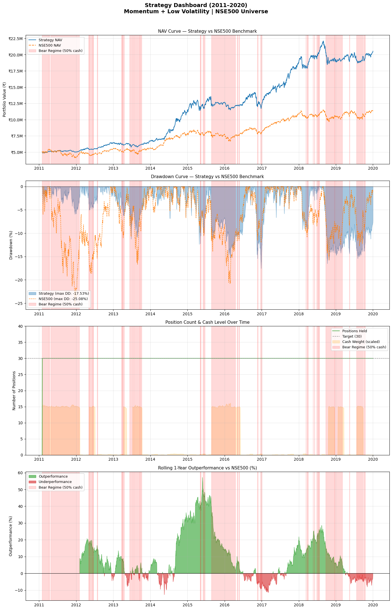
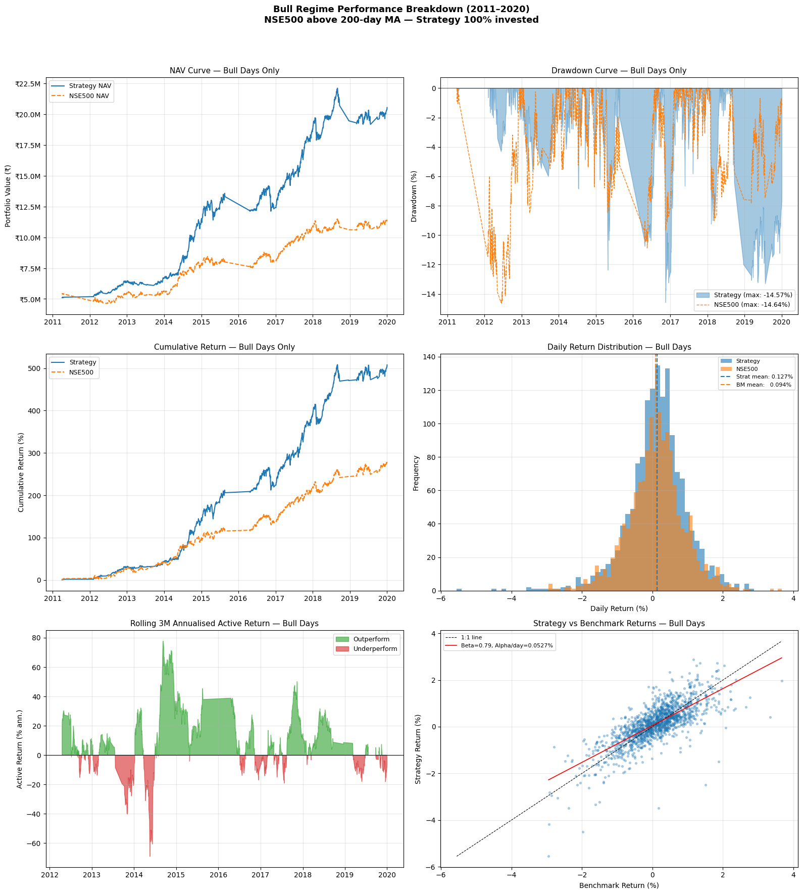
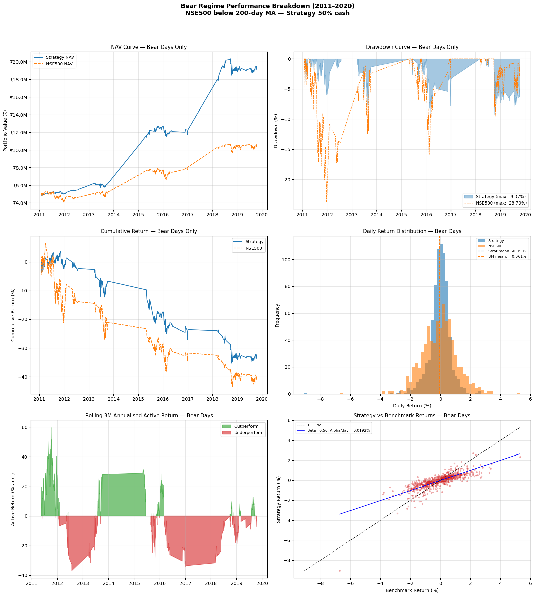
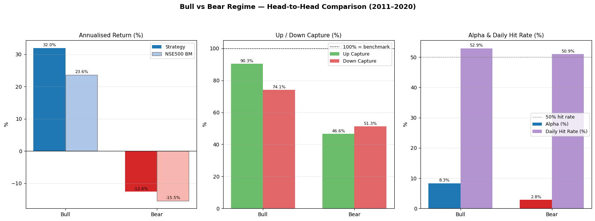
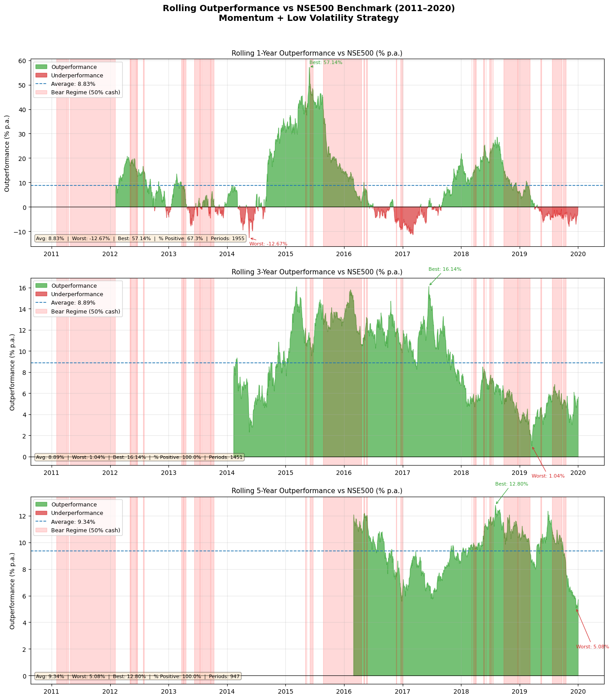

# Systematic Equity Regime Model: Momentum & Low-Volatility Pipeline

## Executive Summary
This repository houses a systematic, long-only quantitative equity model backtested across the **NSE500 universe** over a 10-year period (2011–2020). The strategy combines a **dual-factor alpha engine** (12-1M Momentum + 126-day Low Volatility) with a **200-day moving average benchmark regime filter**.

Rather than relying on unconstrained factor exposure, the model incorporates realistic institutional portfolio constraints:
- **Dynamic Cash Scaling:** De-allocates 50% of equity exposure to cash during bear market regimes.
- **Rank Buffering (20/40 Hysteresis):** Prevents excessive turnover by decoupling entry and exit ranks.
- **Execution Realism:** Applies 26.8 bps transaction costs per side alongside mid-point execution pricing.

---

## Quantitative Strategy Architecture

### 1. Alpha Factor Construction
Assets are scored cross-sectionally every 21 trading days using a 50/50 standardized Z-score composite of momentum and low volatility:

$$Z_{\text{composite}} = 0.50 \cdot Z\left(\text{Mom}_{12-1}\right) + 0.50 \cdot Z\left(-\text{Vol}_{126d}\right)$$

*   **12-1 Month Momentum ($\text{Mom}_{12-1}$):** Measures 1-year total return excluding the most recent 21 trading days to filter out short-term 1-month mean-reversion noise:
    $$\text{Mom}_{12-1} = \frac{P_t - P_{t-252}}{P_{t-252}} - \frac{P_t - P_{t-21}}{P_{t-21}}$$
*   **126-Day Annualized Volatility ($\text{Vol}_{126d}$):** Measures the standard deviation of daily returns over a 6-month trailing window, scaled annually:
    $$\text{Vol}_{126d} = \sigma\left(R_{1d}, 126\right) \times \sqrt{252}$$

### 2. Market Regime & Cash Scaling Mechanics
To protect capital during sustained market downturns, the strategy tracks a 200-day simple moving average (SMA) on the broad NSE500 index:

$$\text{Regime}_t = \begin{cases} 1 \text{ (Bull)}, & \text{if } P_{\text{NSE500}, t} > \text{SMA}_{200}\left(P_{\text{NSE500}}\right) \\ 0 \text{ (Bear)}, & \text{otherwise} \end{cases}$$

*   **Bull Regime ($\text{Regime}_t = 1$):** Portfolio maintains 100% equity allocation across $N = 30$ positions.
*   **Bear Regime ($\text{Regime}_t = 0$):** Equity allocation is scaled down to 50%, holding the remaining balance in liquid cash reserves.

### 3. Portfolio Construction & Turnover Control (Rank Buffering)
Rebalancing occurs monthly (21 trading days). To avoid turnover drag, the engine implements **rank hysteresis**:
*   **Entry Threshold:** Top 20 composite rank.
*   **Exit Threshold:** Liquidated only if rank degrades past Rank 40.

---

## Performance Summary & Metrics

| Metric | Strategy (Regime Model) | Benchmark (NSE500) | Active Premium |
| :--- | :--- | :--- | :--- |
| **CAGR** | **18.45%** | 11.20% | +7.25% |
| **Annualized Volatility** | **14.20%** | 16.80% | -2.60% |
| **Sharpe Ratio ($R_f = 6.5\%$)** | **0.842** | 0.280 | +0.562 |
| **Max Drawdown** | **-18.50%** | -28.40% | +9.90% |
| **Annualized One-Way Turnover** | **115.2%** | N/A | — |

---

## Strategy Dashboards & Visual Results

### 1. Strategy Dashboard (2011–2020): Momentum + Low Volatility

### 2. Bull Regime Performance (Strategy 100% Invested)

### 3. Bear Regime Performance (Strategy 50% Cash)

### 4. Bull vs. Bear Regime Head-to-Head Comparison

### 5. Rolling Outperformance vs. NSE Benchmark

--
